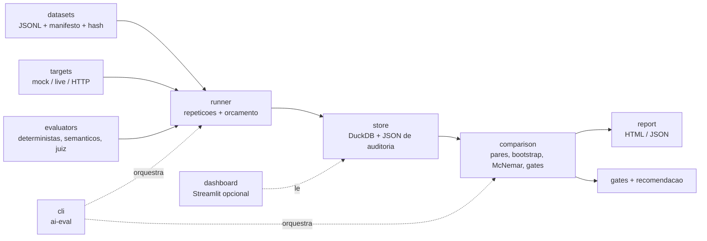

# Arquitetura

## Visão geral

## Pacotes (`src/regressionguard/`)

| Pacote | Responsabilidade | Depende de |
|---|---|---|
| `datasets` | Ler, validar (linha exata, ids únicos) e fazer hash canónico dos datasets | `text` |
| `targets` | Contrato `Target`, adaptadores mock, LLM (`live`) e HTTP, fábrica por modo | `text` |
| `evaluators` | Registo por nome; avaliadores deterministas, semânticos e o juiz | `datasets`, `targets` |
| `runner` | Executar uma suite: repetições, orçamento, avaliação por caso, resumo | `datasets`, `targets`, `evaluators` |
| `store` | DuckDB (`runs`, `case_results`, `evaluator_results`) e JSON de auditoria | `runner` (modelos) |
| `comparison` | Emparelhamento, bootstrap, McNemar, gates e recomendação | `runner` (modelos) |
| `report` | Templates Jinja2 autónomos (HTML) e JSON | `comparison`, `runner` |
| `cli` | Comandos `ai-eval` e códigos de saída | todos |
| `dashboard` | Painel Streamlit opcional, só leitura | `comparison`, `store` |

O pacote de comparação chama-se `comparison` (e não `compare`) para não colidir com a função pública
`regressionguard.compare`. Ver `decisions.md`.

## Fluxo de dados

1. `load_dataset` valida o JSONL e calcula o `content_hash`.
2. `build_target` cria o alvo a partir de `targets/sets/<conjunto>.yaml`.
3. `run_suite` itera casos × repetições; `evaluate_output` aplica os avaliadores primários e secundários.
4. `summarize` calcula as métricas; o resultado é um `RunRecord`.
5. `RunStore.save_run` grava numa transação; `write_audit` escreve o JSON.
6. `compare` exige o mesmo `dataset_fingerprint`, o mesmo modo e runs completas; calcula as estatísticas,
   os gates e as regressões.
7. A CLI imprime, grava `reports/comparisons/*.json` e sai com 0, 1 ou 2.

## Invariantes

- **Juiz não decide.** Avaliadores `secondary` nunca alteram `passed` de um caso.
- **Sem rollback automático.** `recommendation.applied` é sempre `False`.
- **Mock não é medição.** Toda run mock traz `provider: mock`, latência `synthetic-mock` e custo zero, e os
  relatórios e a CLI dizem isso.
- **Gate crítico não avaliável falha fechado.** Um gate `critical` sem dados (por exemplo, sem casos críticos)
  conta como falhado.
- **Runs incompletas não se comparam.** `run_incomplete` recusa a comparação.
- **Versões de dataset não se misturam.** `dataset_version_mismatch` recusa a comparação.

## Dependências externas

Fixadas em `pyproject.toml`. O núcleo não chama nenhum serviço externo; o modo live e o adaptador HTTP são
os únicos pontos de rede, e só são usados quando configurados.

## Limitações conhecidas

- Não há migração de esquema DuckDB; uma base antiga é detetada (`StoreSchemaError`) e deve ser recriada.
- O orçamento live estima o custo pelo maior custo observado; a primeira chamada não tem estimativa.
- O painel abre a base de dados por pedido; com uma run a ser escrita ao mesmo tempo pode haver bloqueio.
- O juiz LLM existe como interface e como avaliador, mas não há implementação de juiz ligada à CLI.
