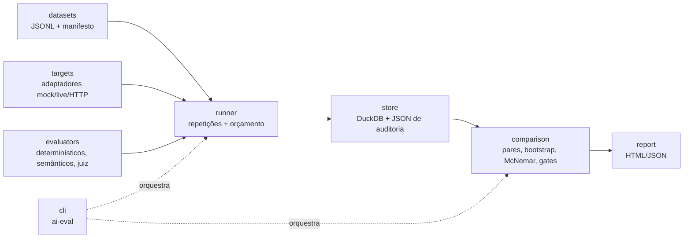

# 00 — Visão geral do RegressionGuard

## O problema

Quando um sistema com LLM muda (prompt, modelo, `top_k` do retrieval, parâmetros de amostragem),
a qualidade pode piorar sem nenhum erro visível. Os testes unitários tradicionais não apanham isto,
porque a saída não é uma função pura do input. O RegressionGuard é um harness que:

1. fixa **datasets golden** (casos com label rastreável);
2. executa um **alvo** (um sistema de IA) sobre esses casos, com **repetições**;
3. pontua cada saída com **avaliadores** explícitos;
4. compara um **candidato** contra um **baseline** de forma emparelhada e estatística;
5. aplica **gates** (críticos bloqueiam, avisos informam) e recomenda, sem executar, um rollback.

## O que entra e o que sai

- **Entra:** um ficheiro JSONL de casos golden, uma configuração de alvo (YAML) e um conjunto de gates (YAML).
- **Sai:** uma run guardada em DuckDB e em JSON de auditoria, um relatório HTML/JSON e, numa comparação,
  um código de saída (`0` aprovado com ou sem avisos, `1` gate crítico falhado, `2` comparação recusada).

A saída real do comando de ajuda da CLI, nesta fase inicial:

```
$ ai-eval --help
                                                                               
 Usage: ai-eval [OPTIONS] COMMAND [ARGS]...                                    
                                                                               
 RegressionGuard: avalia sistemas com LLMs e detecta regressoes.               
                                                                               
+- Options -------------------------------------------------------------------+
| --help        <bool>  Show this message and exit.                           |
+-----------------------------------------------------------------------------+
+- Commands ------------------------------------------------------------------+
| version  Mostra a versao instalada.                                         |
+-----------------------------------------------------------------------------+

```

## Diagrama do pipeline



Cada caixa corresponde a um pacote em `src/regressionguard/`: `datasets`, `targets`, `evaluators`,
`runner`, `store`, `comparison`, `report` e `cli`.

## Porquê esta organização

- Cada pacote tem uma responsabilidade e depende apenas do que está a montante no pipeline.
  O `comparison` não sabe como se chama um modelo; recebe apenas registos de runs.
- A API pública (`regressionguard.compare`, avaliadores, gates, carregamento de datasets) é o que o
  PromptOps importa. Tudo o resto pode mudar sem quebrar essa dependência.

## Como falha

Os testes de arranque estão em `tests/test_cli_smoke.py`. Falhas típicas nesta fase: entry point
`ai-eval` não instalado (correr `pip install -e ".[dev]"`) ou um comando `callback` em falta, que faz
o Typer colapsar a CLI num único comando.

## Perguntas de entrevista

**Porque não usar só testes unitários para LLMs?**
Porque a saída varia entre chamadas e a qualidade é uma propriedade estatística de um conjunto de
casos, não de um caso isolado. Um teste unitário afirma `f(x) == y`; aqui queremos afirmar
"a taxa de sucesso não caiu mais do que 2 pontos percentuais, com 95% de confiança".

**Porque separar o `comparison` do `runner`?**
Para que a decisão (passa/falha) seja reprodutível a partir de runs guardadas, sem voltar a chamar o
modelo. Uma run antiga pode ser recomparada com gates novos.
